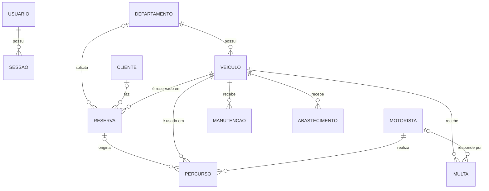

# 03. Modelo Conceitual (MER)

Modelo Entidade-Relacionamento do **Sistema de Controle de Frota**: entidades, atributos, relacionamentos e cardinalidades. Corresponde à fase *Modelagem de Dados* do guia do projeto e é a base do [modelo lógico](04-modelo-logico.md).

> Este modelo reflete o script físico [`database/controle.sql`](../database/controle.sql), que é a referência do banco. Imagem em alta resolução: [`modelagem/diagramas/modelo-conceitual.png`](modelagem/diagramas/modelo-conceitual.png).

---

## 1. Diagrama

O diagrama usa a notação *pé de galinha*: `||` exatamente um · `|o` zero ou um · `o{` zero ou muitos.

## 2. Entidades e atributos

São **11 entidades** (10 do domínio da frota e 1 de apoio, `Sessão`). O identificador é a chave primária; os atributos listados não incluem chaves estrangeiras (representadas pelos relacionamentos) nem o campo de auditoria `data_criacao`. Tipos e restrições de cada atributo estão no [dicionário de dados](05-dicionario-de-dados.md).

| Entidade | Identificador | Atributos |
|---|---|---|
| **Departamento** | `id_departamento` | `nome`, `responsavel`, `ativo` |
| **Usuário** | `id_usr` | `nome`, `email`, `senha`, `perfil`, `ativo`, `ultima_consessao` |
| **Cliente** | `id_cli` | `nome`, `cnpj_cpf`, `ie_rg`, `telefone`, `email`, `uf`, `cidade`, `ativo` |
| **Motorista** | `id_mot` | `nome`, `cpf`, `cnh`, `validade_cnh`, `telefone`, `email`, `uf`, `cidade`, `ativo` |
| **Veículo** | `id_vei` | `placa`, `marca`, `modelo`, `ano_fabricacao`, `ano_modelo`, `cor`, `tipo`, `chassi`, `combustivel`, `capacidade`, `quilometragem_inicial`, `quilometragemAtual`, `status`, `ativo` |
| **Reserva** | `id_res` | `data_reserva`, `hora_ini`, `hora_fim`, `origem`, `destino`, `justificativa`, `status` |
| **Percurso** | `id_perc` | `data_per`, `hora_ini`, `hora_fim`, `origem`, `destino`, `quilometragem`, `observacoes` |
| **Manutenção** | `id_man` | `tipo`, `data_man`, `oficina`, `servico`, `custo`, `quilometragem`, `observacoes`, `proxima_data` |
| **Abastecimento** | `id_aba` | `data_aba`, `hora_aba`, `posto`, `litros`, `valor`, `quilometragem`, `tipo_combustivel`, `observacoes` |
| **Multa** | `id_mul` | `data_infra`, `hora_infra`, `local`, `infracao`, `valor_multa`, `pontos`, `status`, `data_pagamento`, `observacoes` |
| **Sessão** | `id_sess` | `token`, `data_ini`, `data_fim`, `ip`, `navigator`, `ativo` |

> `Sessão` é uma entidade de apoio à autenticação, não do domínio da frota.

## 3. Relacionamentos e cardinalidades

Cardinalidade no formato **(mínimo, máximo)**. A coluna *A → B* indica quantas ocorrências de B se associam a cada A; *B → A*, o inverso.

| Entidade A | Relacionamento | Entidade B | A → B | B → A | Tipo |
|---|---|---|:--:|:--:|:--:|
| Departamento | possui | Veículo | (0,N) | (1,1) | 1:N |
| Departamento | solicita | Reserva | (0,N) | (0,1) | 1:N |
| Cliente | faz | Reserva | (0,N) | (0,1) | 1:N |
| Veículo | é reservado em | Reserva | (0,N) | (1,1) | 1:N |
| Reserva | origina | Percurso | (0,N) | (0,1) | 1:N |
| Veículo | é usado em | Percurso | (0,N) | (1,1) | 1:N |
| Motorista | realiza | Percurso | (0,N) | (1,1) | 1:N |
| Veículo | recebe | Manutenção | (0,N) | (1,1) | 1:N |
| Veículo | recebe | Abastecimento | (0,N) | (1,1) | 1:N |
| Veículo | recebe | Multa | (0,N) | (1,1) | 1:N |
| Motorista | responde por | Multa | (0,N) | (0,1) | 1:N |
| Usuário | possui | Sessão | (0,N) | (1,1) | 1:N |

Pontos de atenção:

- Os relacionamentos **opcionais** (`0,1`) são: `Departamento solicita Reserva`, `Cliente faz Reserva`, `Reserva origina Percurso` e `Motorista responde por Multa`. Na prática, uma reserva pode ser de um cliente **ou** de um departamento (RN08), um percurso pode existir sem reserva, e uma multa pode ainda não ter motorista identificado (RN03).
- **Não há relacionamentos N:M.** Reserva, Percurso, Manutenção, Abastecimento e Multa já funcionam como entidades associativas com atributos próprios, por isso não exigem tabelas de junção.
- **Usuário** e **Motorista** não se relacionam nesta versão (RN05).

## 4. Justificativa das decisões de modelagem

**Usuário separado de Motorista.** Nem todo motorista precisa de credenciais de login (muitos apenas dirigem os veículos) e nem todo usuário do sistema é motorista, podendo ser um funcionário administrativo. Manter as entidades separadas evita misturar controle de acesso com dados operacionais e permite evoluir cada uma sem afetar a outra (por exemplo, acrescentar perfis de permissão a Usuário sem alterar o cadastro de Motorista).

**Reserva separada de Percurso.** Representam momentos distintos do processo: a reserva é a intenção de uso futuro de um veículo (planejamento) e o percurso é o registro do uso efetivamente realizado (execução). A separação permite comparar o planejado com o realizado e identificar reservas que não geraram percurso ou percursos sem reserva prévia. Por isso o vínculo `Percurso → Reserva` é opcional.

**Reserva com solicitante cliente ou departamento.** O mesmo mecanismo atende ao uso externo (reserva de um cliente) e ao uso interno (reserva de um departamento), sem duplicar a entidade.

**Manutenção e Abastecimento independentes.** Ambas se associam ao Veículo, mas têm ciclos e naturezas de custo diferentes: a manutenção é esporádica e ligada a eventos técnicos, e o abastecimento é recorrente e ligado ao uso diário. Separá-las permite calcular indicadores específicos, como custo médio de manutenção por veículo e consumo médio (km/l), sem misturar os dois tipos de despesa.

**Multa ligada ao Veículo e ao Motorista.** A multa é emitida para o veículo (placa), mas o custo e os pontos podem ser repassados ao motorista identificado como condutor na data da infração. A modelagem sustenta relatórios por veículo (multas acumuladas por placa) e por motorista (histórico de infrações).

## 5. Arquivos do BrModelo

Os arquivos `.brM` ficam em [`modelagem/brmodelo/`](modelagem/brmodelo/):

| Arquivo | Conteúdo |
|---|---|
| `conceitual-v1-entidades.brM` | Primeira versão: apenas as 10 entidades do domínio, sem atributos. |
| `conceitual-v2-atributos.brM` | Segunda versão, com atributos. **Corresponde ao desenho anterior ao script SQL** (inclui, por exemplo, `categoria_cnh`, `renavam` e `finalidade`, que não existem no banco atual). |

Nenhum dos dois foi atualizado para o banco atual. A representação vigente é o diagrama Mermaid desta página; se a equipe quiser manter o BrModelo, ele precisa ser ajustado manualmente (ver [07-pendencias-e-evolucao.md](07-pendencias-e-evolucao.md), item P8).
