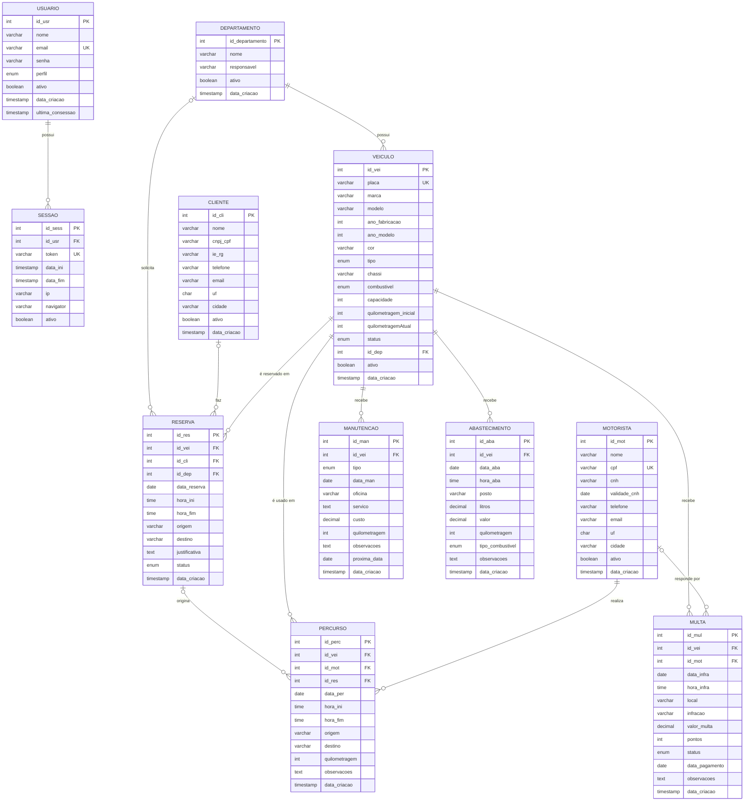

# 04. Modelo Lógico (DER)

Transformação do [modelo conceitual](03-modelo-conceitual.md) em tabelas relacionais: chaves primárias e estrangeiras, tipos e restrições. Cada coluna é descrita no [dicionário de dados](05-dicionario-de-dados.md). Imagem em alta resolução: [`modelagem/diagramas/modelo-logico.png`](modelagem/diagramas/modelo-logico.png).

> **Fonte:** o diagrama foi gerado a partir de [`database/controle.sql`](../database/controle.sql). Legenda: `PK` chave primária · `FK` chave estrangeira · `UK` valor único.

---

## 1. Diagrama

## 2. Regras de transformação aplicadas

1. **Entidade → tabela.** Cada uma das 11 entidades virou uma tabela, com chave primária substituta (`INT AUTO_INCREMENT`).
2. **Relacionamento 1:N → chave estrangeira no lado N.** Os 12 relacionamentos viraram 12 chaves estrangeiras. Quando a participação é opcional (`0,1`), a coluna FK aceita `NULL`.
3. **Sem N:M.** Nenhuma tabela de junção foi necessária (ver [03-modelo-conceitual.md](03-modelo-conceitual.md)).
4. **Domínios fechados → `ENUM`.** Status, tipos e perfis foram modelados como `ENUM`.

## 3. Restrições de integridade

| Tipo | Quantidade | Onde |
|---|:--:|---|
| Chave primária | 11 | uma por tabela |
| Chave estrangeira | 12 | ver [resumo de relacionamentos](05-dicionario-de-dados.md#resumo-dos-relacionamentos) |
| Único (`UNIQUE`) | 4 | `usuario.email`, `motorista.cpf`, `veiculo.placa`, `sessao.token` |
| Domínio (`ENUM`) | 8 | `usuario.perfil`, `veiculo.tipo`, `veiculo.combustivel`, `veiculo.status`, `reserva.status`, `manutencao.tipo`, `abastecimento.tipo_combustivel`, `multa.status` |
| `CHECK` | 0 | não utilizado |

**Comportamento na exclusão:** nenhuma FK define `ON DELETE`, então vale o padrão do InnoDB (`RESTRICT`): não é possível excluir um registro referenciado por outro. Isso sustenta a RN04 (preservar o histórico); para "remover" motoristas, clientes, veículos e departamentos, usa-se a inativação lógica pelo campo `ativo`.

**Regras que o banco não garante** e que dependem da aplicação: sobreposição de reservas (RN01), status do veículo para novo percurso (RN02), solicitante obrigatório na reserva (RN08) e consistência de quilometragem. Uma evolução possível, com `CHECK`, está em [07-pendencias-e-evolucao.md](07-pendencias-e-evolucao.md).

## 4. Normalização até a 3FN

O guia do projeto exige análise até a Terceira Forma Normal.

**1FN: valores atômicos.** Todas as colunas guardam um único valor. Não há grupos repetidos nem campos compostos: cada pessoa tem um telefone e um e-mail, e o endereço do cliente é decomposto em `cidade` e `uf`. O campo `cnpj_cpf` guarda um único documento por registro (CPF ou CNPJ).

**2FN: dependência da chave completa.** Todas as tabelas têm chave primária simples (uma única coluna), portanto não existe dependência parcial.

**3FN: sem dependências transitivas.** Itens examinados:

| Ponto analisado | Conclusão |
|---|---|
| `cidade` e `uf` em `cliente` e `motorista` | São atributos independentes da pessoa; não há par `id_cidade`/`nome_cidade`. Se no futuro for criada uma tabela `cidade`, a dependência passará a existir e deverá ser separada. |
| `valor_multa` e `pontos` em `multa` em relação a `infracao` | O valor e os pontos poderiam depender do tipo de infração, mas são registrados conforme o auto recebido (que pode variar). Mantidos na tabela; se for criado um catálogo de infrações, devem migrar para ele. |
| `quilometragemAtual` e `status` em `veiculo` | **Redundância controlada:** resumem eventos registrados em outras tabelas (percursos, manutenções). São mantidos para evitar recálculo e precisam ser atualizados pela aplicação. |
| `id_dep` em `reserva` e em `veiculo` | Não é redundância: em `veiculo` é o departamento responsável; em `reserva`, o solicitante. |

**Conclusão:** o modelo atende à 3FN, com a redundância controlada acima documentada.
