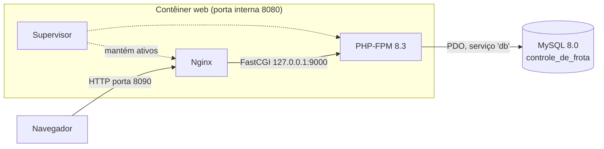

# 06. Estrutura e Arquitetura do Projeto

Organização atual do repositório e visão geral da arquitetura. Este documento substitui a antiga "árvore de arquivos", que descrevia uma estrutura em camadas (`config/`, `public/`, `src/models`, `src/controllers`, `src/views`) **que não foi adotada**: o projeto usa páginas PHP organizadas por módulo.

---

## 1. Arquitetura



- **Aplicação:** imagem `php:8.3-fpm-alpine` com Nginx e Supervisor no mesmo contêiner. O Nginx serve os arquivos estáticos e delega `.php` ao PHP-FPM; qualquer rota inexistente cai em `index.html`.
- **Banco:** serviço `db` com `mysql:8.0`. O script `database/controle.sql` é copiado para `/docker-entrypoint-initdb.d/` e executado **somente na primeira inicialização** do volume `db_data`.
- **Conexão:** `includes/connect.php` abre a conexão PDO (`utf8mb4`, exceções ativas, *prepared statements* reais) usando as constantes de `includes/db.php`, que lê variáveis de ambiente.
- **Páginas protegidas:** cada página interna inclui `includes/auth.php`, que exige sessão ativa e recarrega o usuário do banco.

### Variáveis de ambiente

| Variável | Uso | Valor no `docker-compose.yml` |
|---|---|---|
| `DB_HOST` | Host do MySQL | `db` |
| `DB_NAME` | Nome do banco | `controle_de_frota` |
| `DB_USER` | Usuário do banco | `controle` |
| `DB_PASSWORD` | Senha do banco | definida no compose (somente desenvolvimento) |

`includes/db.php` define valores padrão para execução fora do Docker.

---

## 2. Estrutura de pastas

Legenda: **(vazio)** = arquivo criado, mas ainda sem conteúdo.

```text
controle-de-frota/
├── README.md                      Apresentação e como executar
├── Dockerfile                     Imagem da aplicação (PHP 8.3-FPM + Nginx + Supervisor)
├── docker-compose.yml             Serviços web e db, volume db_data, rede externa "coolify"
├── nginx.conf                     Nginx na porta 8080; .php vai para o PHP-FPM
├── supervisord.conf               Mantém php-fpm e nginx no mesmo contêiner
├── .dockerignore
│
├── index.html                     Página inicial pública (DriveHub)
├── login.php                      Autenticação (e-mail e senha)
├── logout.php                     Encerra a sessão
├── recuperar-senha.php            (vazio)
├── 404.php                        Página de erro
│
├── includes/                      Código compartilhado
│   ├── db.php                     Constantes do banco e fuso horário (America/Sao_Paulo)
│   ├── connect.php                Conexão PDO
│   ├── auth.php                   Exige sessão válida; permissões de gestão de usuários
│   ├── header.php                 Layout, menu lateral e cabeçalho
│   ├── footer.php                 Rodapé
│   └── csrf.php · flash.php · upload.php · validation.php   (vazios)
│
├── dashboard/                     Área logada
│   ├── index.php                  Painel: indicadores e alertas
│   ├── usuarios/                  CRUD de usuários (create, edit, index, view)
│   ├── veiculos/                  create · edit · index · view            (vazios)
│   ├── motoristas/                create · edit · index · view            (vazios)
│   ├── viagens/                   create · edit · index · view            (vazios)
│   ├── abastecimentos/            create · edit · index · view            (vazios)
│   ├── manutencao/                create · edit · index · view            (vazios)
│   ├── relatorios/                index · consumo · custos · manutencoes · viagens   (vazios)
│   ├── alertas/                   index                                   (vazio)
│   ├── pneus/ · despesas/ · fornecedores/ · documentos/ · sinistros/      (vazios; sem tabela no banco)
│   ├── empresas/                  edit                                    (vazio; sem tabela no banco)
│   └── config.php · documento.php · exportar.php                          (vazios)
│
├── usuario/                       Conta do usuário logado
│   ├── index.php                  Minha conta
│   ├── config-perfil.php          Alterar nome, e-mail e senha
│   └── deletar-conta.php          Excluir a própria conta
│
├── api/index.php                  (vazio)
├── cron/verificar-vencimentos.php (vazio)
│
├── static/                        Arquivos estáticos
│   ├── css/                       app, auth, dashboard, formularios, global, layout, responsivo, tabelas
│   └── vendor/bootstrap-5.3.3/    Bootstrap (css e js)
├── assets/                        css/dashboard.css · js/dashboard.js     (vazios)
│
├── database/
│   ├── controle.sql               Script físico: cria o banco e as 11 tabelas
│   └── Dockerfile                 Imagem MySQL que executa o script na inicialização
│
└── docs/                          Documentação (ver docs/README.md)
```

## 3. Situação da implementação

Dos 92 arquivos do projeto (sem contar `docs/` e o Bootstrap), **33 têm código e 59 estão vazios**.

| Área | Situação |
|---|---|
| Autenticação (login, logout, `auth.php`) | Com código |
| Painel (`dashboard/index.php`) | Com código |
| Gestão de usuários e "minha conta" | Com código |
| Layout, estilos e conexão com o banco | Com código |
| CRUD de veículos, motoristas, viagens, abastecimentos, manutenção | Esqueleto |
| Relatórios, alertas, API, cron, recuperação de senha | Esqueleto |
| Reservas, clientes, multas e departamentos | **Sem arquivos** (existem no banco) |
| Pneus, despesas, fornecedores, documentos, sinistros, empresas | Esqueleto, mas **sem tabela no banco** |

A matriz completa por requisito está em [02-requisitos.md](02-requisitos.md#5-matriz-de-rastreabilidade). As divergências entre interface e banco estão em [07-pendencias-e-evolucao.md](07-pendencias-e-evolucao.md).
